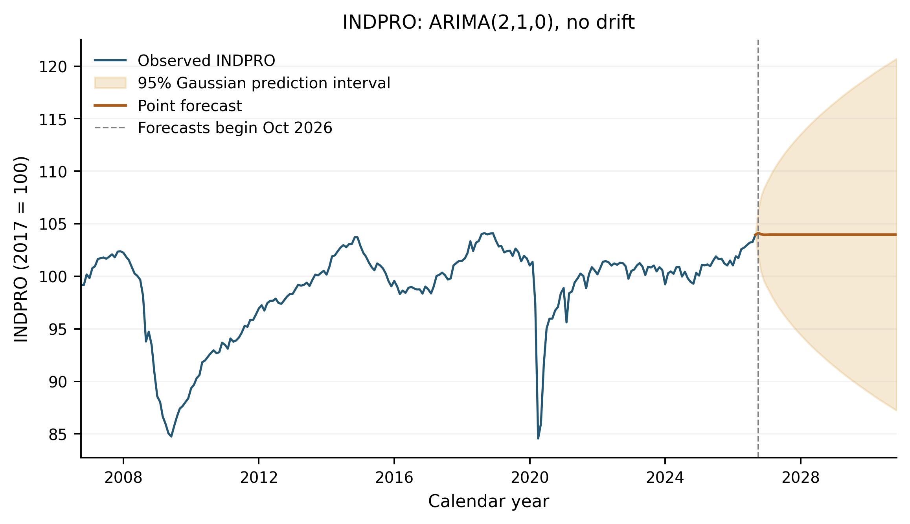

# U.S. Industrial Production Forecasting

**ARIMA Modeling, Residual Diagnostics, and Prediction Interval Sensitivity**

A reproducible Python analysis of U.S. industrial production using ARIMA models and residual-bootstrap simulation.

## Overview

**Research question:** How effectively can a parsimonious ARIMA model capture temporal dependence, and how sensitive are its 50-month prediction intervals to the innovation distribution?

The analysis follows a Box–Jenkins workflow: exploratory analysis, model identification and selection, residual diagnostics, and forecasting. Comparing Gaussian and residual-bootstrap prediction intervals examines the implications of non-Gaussian residuals.



[Final report](report/Project_1.pdf) · [Executed notebook](notebooks/01_indpro_analysis.ipynb) · [Vector forecast figure](figures/figure_4_forecast.pdf)

## Dataset

The Federal Reserve Board's **Industrial Production: Total Index (INDPRO)**, distributed through [FRED](https://fred.stlouisfed.org/series/INDPRO), is monthly and seasonally adjusted, with 2017 = 100. Estimation uses **October 2006–September 2026: 240 observations**. All COVID-19 observations are retained unchanged.

The [original CSV snapshot](data/raw/INDPRO_2026-10-22.csv), downloaded October 22, 2026, includes the full history; the notebook selects the fixed estimation window. Using this frozen file prevents later FRED revisions from changing the analysis. No data download or API key is needed. See [data provenance and attribution](data/README.md).

## Methodology and key findings

The analysis retains the original index scale and uses first differencing to address strong persistence. No seasonal differencing is applied: the series is already seasonally adjusted, and the differenced ACF shows no pronounced annual dependence. See the [historical series](figures/figure_1_historical.png) and [ACF/PACF figure](figures/figure_2_acf_pacf.png).

Six low-order integrated ARIMA specifications, each with and without drift, are compared using Gaussian state-space maximum likelihood and AICc. The correction uses an effective likelihood sample of 239 and counts innovation variance among the estimated parameters; see the [model comparison](results/model_comparison.csv).

The selected **ARIMA(2,1,0), without drift**, is

$$
\Delta y_t = 0.242541\,\Delta y_{t-1} - 0.198845\,\Delta y_{t-2} + \varepsilon_t,
\qquad \widehat{\sigma}^{2} = 1.323609.
$$

Its AICc is **751.485410**, compared with **753.111109** for no-drift ARIMA(0,1,2); the gap of **1.625699** leaves both plausible. Adding drift to ARIMA(2,1,0) raises AICc to **753.494224**. Full inference is in the [parameter table](results/parameters.csv).

Diagnostics use **239 post-initialization residuals**. Adjusted [Ljung–Box tests](results/ljung_box.csv) at lags 6, 10, 12, 18, and 24 do not reject zero residual autocorrelation at the 5% level. This does not prove independence or normality: the isolated lag-10 feature, extreme April 2020 shock, heavy tails, and uneven variability remain visible in the [residual diagnostics](figures/figure_3_residual_diagnostics.png).

## Forecasts and bootstrap sensitivity

The 50-month horizon runs from **October 2026 through November 2030**. Point forecasts approach **103.968** as predicted monthly changes decay toward zero; this is a statistical baseline, not a claim about long-term economic growth.

The bootstrap independently resamples **239 centered residuals** to simulate **20,000 paths**, using seed **20261102** and holding parameters fixed. Empirical 2.5th and 97.5th percentiles define the bootstrap limits. The table reports marginal 95% prediction intervals for future observations, not parameter confidence intervals or simultaneous path bands.

| Horizon (months) | Gaussian interval | Bootstrap interval | Bootstrap width vs. Gaussian |
| --- | --- | --- | --- |
| 1 | [101.85, 106.36] | [101.94, 105.47] | 21.7% narrower |
| 12 | [95.68, 112.26] | [91.94, 110.62] | 12.6% wider |
| 50 | [87.23, 120.70] | [85.08, 118.25] | 0.9% narrower |

Source outputs: [all Gaussian forecasts](results/forecasts.csv) and [bootstrap comparison](results/bootstrap_comparison.csv). These differences show sensitivity to the innovation distribution, not superior bootstrap coverage.

## Reproducibility

Tested with **Python 3.13.5**. [requirements.txt](requirements.txt) pins NumPy 2.3.1, pandas 2.3.1, SciPy 1.16.0, Matplotlib 3.10.8, statsmodels 0.14.5, and the notebook execution dependencies.

From the repository root, on macOS/Linux:

```bash
python3.13 -m venv .venv
source .venv/bin/activate
python -m pip install -r requirements.txt
python scripts/reproduce.py
```

The [runner](scripts/reproduce.py) executes the notebook using the same Python interpreter, writes its executed outputs, and regenerates `figures/` and `results/`. It uses repository-relative paths, works offline after installation, and leaves the frozen CSV and report unchanged. Existing outputs can be inspected without running it.

The recorded clean-environment run passed all **14 reference checks**; see [validation results](results/validation.json), [runtime versions and metrics](results/metrics.json), and [audit details](AUDIT.md). One reproducibility caveat remains: the clean PyPI/Apple Accelerate build reports a line-search convergence warning for the **unselected no-drift ARIMA(0,1,1)**, while the original OpenBLAS build converged. The selected ARIMA(2,1,0) converges in both, and numerical references agree within documented tolerances. The [warning record](results/estimation_warnings.json) and comparison table preserve this distinction; the failed candidate is not certified as converged.

## Limitations

There is no out-of-sample accuracy or empirical interval-coverage validation. Heavy tails, potential time-varying volatility, and structural changes limit interpretation, especially over the long forecast horizon. Independent residual resampling does not model volatility clustering, and both interval methods hold parameters fixed, excluding parameter-estimation uncertainty. Adequate historical linear-dependence diagnostics do not establish reliable future uncertainty estimates.

Data attribution: Board of Governors of the Federal Reserve System (US), *Industrial Production: Total Index* [INDPRO], via FRED, Federal Reserve Bank of St. Louis; retrieved October 22, 2026. No license is included.

## Acknowledgments

Developed for Professor Clifford Hurvich's STAT-GB 6018 *Forecasting Time Series Data* course at NYU Stern. Python and statsmodels were used for statistical analysis, with OpenAI Codex assisting in code development and repository organization.
